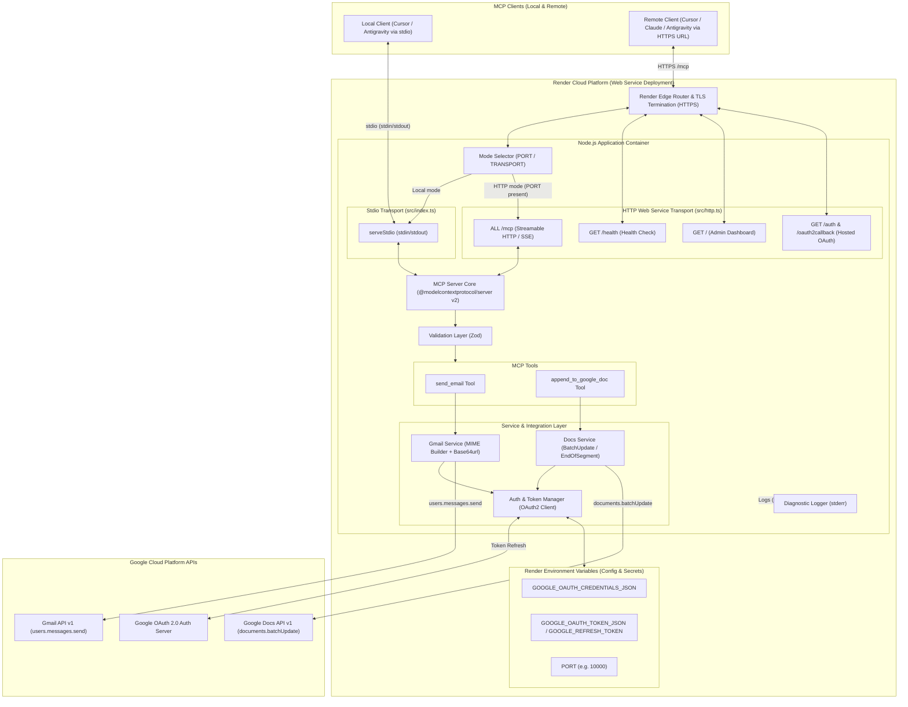
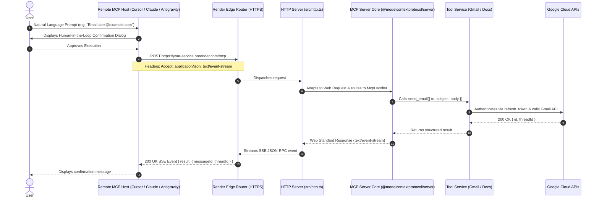

# System Architecture: Google Workspace MCP Server (Local & Render Cloud Deployment)

This document details the architectural design, component decomposition, data flows, security boundaries, and protocol specifications for the **Google Workspace Model Context Protocol (MCP) Server**, supporting both **local stdio execution** and **remote cloud deployment on Render**.

---

## 1. Executive Summary & Design Principles

The Google Workspace MCP Server connects AI coding assistants (such as Google Antigravity, Cursor, Claude Code, and Claude Desktop) to a user's Google account to safely execute write operations via Gmail and Google Docs.

### Architectural Core Principles
1. **Dual Transport Support:**
   - **Local `stdio` Transport:** High-performance direct pipe for local developer workstations.
   - **Remote Streamable HTTP / SSE Transport:** Cloud-ready web service for hosted environments like **Render**, allowing remote client assistants to connect over secure HTTPS.
2. **Strict Protocol & Stream Isolation:**
   - Under `stdio` mode: `stdout` is reserved strictly for JSON-RPC messages; all diagnostics and logs route to `stderr`.
   - Under HTTP/Render mode: Clean HTTP/SSE streaming responses on `/mcp`, dedicated healthcheck on `/health`, and structured diagnostics routed to logging collectors.
3. **Flexible Authentication Lifecycle:**
   - **Local Mode:** Interactive CLI consent flow (`npm run auth`) via local loopback listener storing refreshable tokens in `.tokens/token.json`.
   - **Cloud Mode (Render):** Headless configuration using environment variables (`GOOGLE_OAUTH_CREDENTIALS_JSON` and `GOOGLE_OAUTH_TOKEN_JSON` or `GOOGLE_REFRESH_TOKEN`), with optional hosted browser OAuth via `/auth` and `/oauth2callback`.
4. **Human-in-the-Loop Confirmation:** Side-effect operations require explicit client confirmation before execution.
5. **No Blind Retries (At-Most-Once Delivery):** Ambiguous network errors or failures never trigger automatic retries, preventing duplicate emails or duplicate document appends.

---

## 2. System Context & Architecture Diagram



---

## 3. Subsystem Breakdown & Source Modules

| Module | File Path | Responsibilities |
| :--- | :--- | :--- |
| **Server Entrypoint** | `src/index.ts` | Detects runtime mode (`PORT` or `TRANSPORT=http` vs `stdio`), initializes MCP server instance, registers tools, and starts either the HTTP or Stdio transport. |
| **HTTP Web Service** | `src/http.ts` | Hosts Render-compliant HTTP web service: `/health` endpoint, `/` dashboard, `/mcp` Streamable HTTP protocol route, and `/auth` + `/oauth2callback` hosted OAuth flow. |
| **Authentication Module** | `src/auth.ts` | Hybrid credential loader (supports `GOOGLE_OAUTH_CREDENTIALS_JSON`, individual env vars, and disk files), hybrid token loader (`GOOGLE_OAUTH_TOKEN_JSON`, `GOOGLE_REFRESH_TOKEN`, and `.tokens/token.json`), in-memory token caching, and automatic token refresh. |
| **Interactive Authorizer** | `scripts/authorize.ts` | CLI script (`npm run auth`) for local interactive OAuth setup with local browser loopback. |
| **Validation Layer** | `src/validation.ts` | Zod validation schemas, CR/LF email header injection prevention, and Google Docs URL-to-ID parser. |
| **Gmail Handler** | `src/gmail.ts` | RFC 5322 MIME compilation, Base64url encoding, and Gmail API dispatch (`users.messages.send`). |
| **Docs Handler** | `src/docs.ts` | Google Docs `documents.batchUpdate` append handler with `endOfSegmentLocation` and leading newline separation. |
| **Logger** | `src/logger.ts` | Enforces zero stdout pollution; routes all diagnostic messages to `stderr`. |
| **Render Blueprint** | `render.yaml` | Declarative Infrastructure-as-Code specification for automated deployment on Render. |

---

## 4. Render Deployment Architecture

### 4.1. Runtime Mode Detection
When deployed to Render, the platform automatically provides a `PORT` environment variable (typically `10000`). The server entry point detects this environment:
```typescript
const isHttpMode = Boolean(process.env.PORT) || process.env.TRANSPORT === "http";

if (isHttpMode) {
  startHttpServer(parseInt(process.env.PORT || "3000", 10), createServer);
} else {
  serveStdio(() => createServer());
}
```
This enables seamless dual-mode execution without separate entry points:
- **Local Development:** Default to `stdio`.
- **Render Cloud Service:** Automatically runs the HTTP web service.

---

### 4.2. Render Endpoints Specification

| Route | Method | Purpose | Response |
| :--- | :--- | :--- | :--- |
| `/health` | `GET` | Render Health Check & Uptime Monitoring | `200 OK` `{ status: "ok", service: "...", authenticated: true/false }` |
| `/` | `GET` | Status Dashboard & Configuration Guide | `200 OK` HTML Dashboard with connection status and configuration snippets |
| `/mcp` | `ALL` | MCP Streamable HTTP / SSE Protocol Endpoint | `200 OK` JSON-RPC over Server-Sent Events / Streamable HTTP |
| `/auth` | `GET` | Cloud OAuth Trigger | `302 Redirect` to Google OAuth consent screen |
| `/oauth2callback` | `GET` | Hosted OAuth Callback | `200 OK` Exchanges code for tokens, loads into memory, and displays JSON for persistent configuration |

---

### 4.3. Cloud Credential & Token Persistence Model

On Render web services, disk storage can be ephemeral across restarts. The authentication layer handles this via environment variables:

1. **Client Credentials:**
   Set `GOOGLE_OAUTH_CREDENTIALS_JSON` in the Render Dashboard with the contents of your Google OAuth client JSON file:
   ```json
   {"installed":{"client_id":"...","client_secret":"...","redirect_uris":["..."]}}
   ```
2. **User Authorization Tokens:**
   Set `GOOGLE_OAUTH_TOKEN_JSON` (the stringified content of `.tokens/token.json`) or `GOOGLE_REFRESH_TOKEN` in Render.
   - When the access token expires, Google OAuth refreshes it automatically using the `refresh_token`.
   - Updated tokens are cached in container memory during runtime.
   - For complete persistence across container rebuilds, the `refresh_token` remains perpetually valid until explicitly revoked.

---

### 4.4. Render Blueprint (`render.yaml`)
```yaml
services:
  - type: web
    name: google-workspace-mcp
    runtime: node
    plan: free
    region: oregon
    buildCommand: npm install && npm run build
    startCommand: npm start
    healthCheckPath: /health
    envVars:
      - key: NODE_ENV
        value: production
      - key: TRANSPORT
        value: http
      - key: GOOGLE_OAUTH_CREDENTIALS_JSON
        sync: false
      - key: GOOGLE_OAUTH_TOKEN_JSON
        sync: false
      - key: GOOGLE_REFRESH_TOKEN
        sync: false
      - key: GOOGLE_CLIENT_ID
        sync: false
      - key: GOOGLE_CLIENT_SECRET
        sync: false
      - key: GOOGLE_REDIRECT_URI
        sync: false
```

---

## 5. Sequence Workflows

### 5.1. Remote MCP Tool Execution over HTTP/SSE (Render)



---

## 6. Remote Host Client Configuration Examples

When the server is deployed on Render, clients connect via its remote HTTPS URL (`https://<service-name>.onrender.com/mcp`):

### Cursor Configuration (`.cursor/mcp.json`)
```json
{
  "mcpServers": {
    "google-workspace": {
      "url": "https://your-service.onrender.com/mcp"
    }
  }
}
```

### Google Antigravity Configuration (`.agents/mcp_config.json`)
```json
{
  "mcpServers": {
    "google-workspace": {
      "url": "https://your-service.onrender.com/mcp"
    }
  }
}
```

### Claude Desktop / Claude Code Configuration
```json
{
  "mcpServers": {
    "google-workspace": {
      "url": "https://your-service.onrender.com/mcp"
    }
  }
}
```

---

## 7. Security & Cloud Best Practices

1. **HTTPS / TLS Enforcement:** All traffic to Render is terminated with SSL/TLS at the Render edge router. External clients communicate solely over encrypted `https://`.
2. **Environment Variable Encryption:** Sensitive credentials (`GOOGLE_OAUTH_CREDENTIALS_JSON`, `GOOGLE_OAUTH_TOKEN_JSON`, and `GOOGLE_REFRESH_TOKEN`) are marked with `sync: false` in `render.yaml` and encrypted within the Render secrets store.
3. **Restricted OAuth Scopes:** The server restricts permissions exclusively to `gmail.send` and `documents`. No read, search, or deletion access is ever requested.
4. **Human-in-the-Loop Gate:** Irreversible actions require user confirmation on the client host before invocation.
5. **At-Most-Once Delivery:** Retries are strictly avoided on ambiguous network dropouts to prevent sending duplicate emails or appending duplicate paragraphs.
