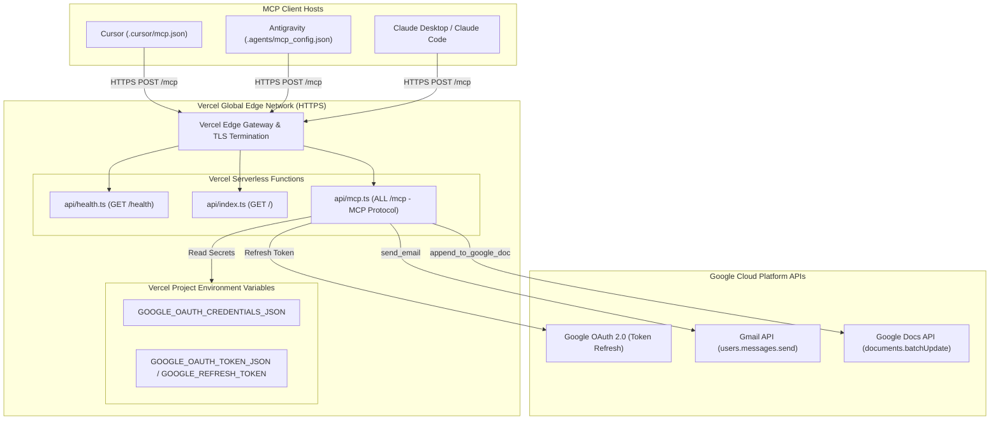

# Deployment Plan: Google Workspace MCP Server on Vercel

This document outlines the end-to-end plan, architectural adaptations, configuration files, and step-by-step procedures to deploy the **Google Workspace Model Context Protocol (MCP) Server** onto **Vercel** as a serverless service.

---

## 1. Executive Summary & Serverless Architecture

Deploying an MCP server on Vercel transitions the runtime from a long-lived process (such as local `stdio` or containerized Render) to an on-demand **Serverless Function architecture**.

### Key Architectural Differences

| Feature | Local (stdio) / Render (Container) | Vercel (Serverless) |
| :--- | :--- | :--- |
| **Execution Model** | Persistent long-running process | Ephemeral Serverless Functions (spun up on demand) |
| **Transport** | Standard input/output stream (`stdio`) / Node HTTP | Web Standard Request/Response (`fetch` API) via `/mcp` |
| **Streaming / SSE** | Persistent stream connection | Vercel Serverless Streaming / Server-Sent Events |
| **Filesystem** | Local writable disk | Read-only filesystem (ephemeral `/tmp` only) |
| **State & Tokens** | Local file storage (`.tokens/token.json`) | Environment Variables (`GOOGLE_OAUTH_TOKEN_JSON` or `GOOGLE_REFRESH_TOKEN`) |
| **Billing / Resource** | Always-on container compute | Scale-to-zero (pay only per request invocation) |

---

## 2. Compatibility & Runtime Mapping

The codebase already utilizes `@modelcontextprotocol/server` (MCP SDK v2), which includes native Web Standard `fetch` support via `createMcpHandler(factory, { legacy: "stateless" })`.

### Serverless Compatibility
1. **Stateless Handler:** Vercel serverless functions handle requests independently. `createMcpHandler` operates in `legacy: "stateless"` or modern per-request mode.
2. **Environment Variable Authentication:** The `src/auth.ts` module already supports:
   - `GOOGLE_OAUTH_CREDENTIALS_JSON` (Google Cloud credentials JSON string)
   - `GOOGLE_OAUTH_TOKEN_JSON` (Full authorization token JSON string)
   - `GOOGLE_REFRESH_TOKEN` (Direct refresh token string)
3. **Automatic Access Token Refresh:** On each serverless request, `google-auth-library` uses the persistent `refresh_token` to fetch a new access token if the cached one has expired.

---

## 3. Architecture & Routing Diagram on Vercel



---

## 4. Required Project Files for Vercel

To deploy on Vercel, we organize serverless entry points in an `api/` directory and add a `vercel.json` configuration file.

### 4.1. `vercel.json`
Specifies routing, function execution limits, and CORS headers:

```json
{
  "$schema": "https://openapi.vercel.sh/vercel.json",
  "version": 2,
  "buildCommand": "npm run build",
  "outputDirectory": "dist",
  "framework": null,
  "functions": {
    "api/**/*.ts": {
      "memory": 1024,
      "maxDuration": 30
    }
  },
  "rewrites": [
    { "source": "/health", "destination": "/api/health" },
    { "source": "/mcp", "destination": "/api/mcp" },
    { "source": "/", "destination": "/api/index" }
  ]
}
```

---

### 4.2. `api/mcp.ts` (Core MCP Endpoint)
Handles incoming Model Context Protocol requests over HTTP:

```typescript
import { createMcpHandler } from "@modelcontextprotocol/server";
import { createServer } from "../src/index";

export const maxDuration = 30; // 30 seconds execution limit

const handler = createMcpHandler(() => createServer(), {
  legacy: "stateless",
});

export async function POST(request: Request): Promise<Response> {
  return handler.fetch(request);
}

export async function GET(request: Request): Promise<Response> {
  return handler.fetch(request);
}
```

---

### 4.3. `api/health.ts` (Health Check Endpoint)
Used by monitoring and clients to verify service availability:

```typescript
import { loadTokens } from "../src/auth";

export async function GET(): Promise<Response> {
  const isAuthReady = Boolean(loadTokens());

  return new Response(
    JSON.stringify({
      status: "ok",
      service: "google-workspace-mcp",
      platform: "vercel-serverless",
      version: "1.0.0",
      authenticated: isAuthReady,
      tools: ["send_email", "append_to_google_doc"],
      timestamp: new Date().toISOString(),
    }),
    {
      status: 200,
      headers: { "Content-Type": "application/json" },
    }
  );
}
```

---

### 4.4. `api/index.ts` (Landing Dashboard)
Presents a status dashboard and MCP configuration snippets for users who visit the root URL:

```typescript
import { loadTokens } from "../src/auth";

export async function GET(request: Request): Promise<Response> {
  const url = new URL(request.url);
  const isAuthReady = Boolean(loadTokens());
  const baseUrl = `${url.protocol}//${url.host}`;

  const html = `<!DOCTYPE html>
<html>
<head>
  <title>Google Workspace MCP Server (Vercel)</title>
  <style>
    body { font-family: -apple-system, BlinkMacSystemFont, "Segoe UI", Roboto, sans-serif; max-width: 800px; margin: 40px auto; padding: 0 20px; line-height: 1.6; }
    code { background: #f6f8fa; padding: 2px 6px; border-radius: 4px; font-size: 85%; }
    pre { background: #f6f8fa; padding: 16px; border-radius: 6px; overflow-x: auto; }
    .badge { display: inline-block; padding: 4px 10px; border-radius: 12px; font-size: 13px; font-weight: 600; }
    .badge-ok { background: #e6f4ea; color: #137333; }
    .badge-warn { background: #fef7e0; color: #b06000; }
    .card { border: 1px solid #e1e4e8; border-radius: 8px; padding: 20px; margin: 20px 0; }
  </style>
</head>
<body>
  <h1>Google Workspace MCP Server</h1>
  <p>Deployed as a Serverless Service on <strong>Vercel</strong>.</p>
  
  <div class="card">
    <h3>Service Status</h3>
    <p><strong>Platform:</strong> Vercel Serverless Functions</p>
    <p><strong>Authentication:</strong> ${isAuthReady ? '<span class="badge badge-ok">Authorized</span>' : '<span class="badge badge-warn">Missing Token</span>'}</p>
    <p><strong>MCP Endpoint:</strong> <code>${baseUrl}/mcp</code></p>
    <p><strong>Health Check:</strong> <a href="/health"><code>/health</code></a></p>
  </div>

  <div class="card">
    <h3>Client Configuration</h3>
    <pre><code>{
  "mcpServers": {
    "google-workspace": {
      "url": "${baseUrl}/mcp"
    }
  }
}</code></pre>
  </div>
</body>
</html>`;

  return new Response(html, {
    status: 200,
    headers: { "Content-Type": "text/html; charset=utf-8" },
  });
}
```

---

## 5. Environment Variables Configuration on Vercel

Before or during deployment, configure the following secrets in the [Vercel Project Dashboard](https://vercel.com/dashboard) under **Settings > Environment Variables**:

| Variable Name | Description | Example / Source |
| :--- | :--- | :--- |
| `GOOGLE_OAUTH_CREDENTIALS_JSON` | Raw stringified JSON of Google OAuth client credentials | Content of `secrets/credentials.json` |
| `GOOGLE_OAUTH_TOKEN_JSON` | Raw stringified JSON of authorized OAuth tokens | Content of `.tokens/token.json` |
| `GOOGLE_REFRESH_TOKEN` | *(Alternative to token JSON)* Raw refresh token string | Extracted `refresh_token` field |
| `NODE_ENV` | Node execution environment | `production` |

> [!IMPORTANT]
> Because Vercel serverless environments are ephemeral and read-only, authorization tokens cannot be generated on Vercel via local loopback. Generate `.tokens/token.json` locally first with `npm run auth`, then copy the contents into Vercel's `GOOGLE_OAUTH_TOKEN_JSON`.

---

## 6. Step-by-Step Deployment Procedure

### Phase 1: Local Prerequisites & Token Generation
1. Ensure your local `secrets/credentials.json` is configured.
2. Run the local authorization command:
   ```bash
   npm run auth
   ```
3. Confirm that `.tokens/token.json` has been generated and validated.

---

### Phase 2: Deploy to Vercel

#### Method A: Deploy via GitHub / GitLab (Recommended for CI/CD)
1. Push the project to GitHub (sensitive folders `secrets/` and `.tokens/` are excluded by `.gitignore`):
   ```bash
   git add .
   git commit -m "feat: add Vercel serverless deployment support"
   git push origin main
   ```
2. Navigate to [vercel.com/new](https://vercel.com/new) and import the repository.
3. Under **Build and Output Settings**, leave defaults (`npm run build`).
4. Under **Environment Variables**, add:
   - `GOOGLE_OAUTH_CREDENTIALS_JSON`: Paste contents of `secrets/credentials.json`.
   - `GOOGLE_OAUTH_TOKEN_JSON`: Paste contents of `.tokens/token.json`.
5. Click **Deploy**.

---

#### Method B: Deploy via Vercel CLI
1. Install the Vercel CLI globally:
   ```bash
   npm install -g vercel
   ```
2. Link and deploy to Vercel:
   ```bash
   vercel
   ```
3. Add the environment variables via CLI or the web dashboard:
   ```bash
   vercel env add GOOGLE_OAUTH_CREDENTIALS_JSON production
   vercel env add GOOGLE_OAUTH_TOKEN_JSON production
   ```
4. Deploy to production:
   ```bash
   vercel --prod
   ```

---

## 7. Verification & Testing

Once Vercel assigns your production URL (e.g., `https://google-workspace-mcp.vercel.app`), verify the deployment:

### 1. Test Health Endpoint
```bash
curl -i https://your-project.vercel.app/health
```
Expected output:
```json
{
  "status": "ok",
  "service": "google-workspace-mcp",
  "platform": "vercel-serverless",
  "version": "1.0.0",
  "authenticated": true,
  "tools": ["send_email", "append_to_google_doc"]
}
```

### 2. Test MCP Protocol Handshake (`tools/list`)
```bash
curl -X POST https://your-project.vercel.app/mcp \
  -H "Content-Type: application/json" \
  -H "Accept: application/json, text/event-stream" \
  -d '{
    "jsonrpc": "2.0",
    "id": 1,
    "method": "initialize",
    "params": {
      "protocolVersion": "2024-11-05",
      "clientInfo": { "name": "verification-client", "version": "1.0.0" },
      "capabilities": {}
    }
  }'
```
Expected output: A `200 OK` response with `text/event-stream` returning the protocol handshake and server metadata.

---

## 8. Client Host Configurations for Vercel

Configure your AI assistant clients to communicate with your Vercel URL:

### Cursor (`.cursor/mcp.json`)
```json
{
  "mcpServers": {
    "google-workspace": {
      "url": "https://your-project.vercel.app/mcp"
    }
  }
}
```

### Google Antigravity (`.agents/mcp_config.json`)
```json
{
  "mcpServers": {
    "google-workspace": {
      "url": "https://your-project.vercel.app/mcp"
    }
  }
}
```

### Claude Desktop / Claude Code
```json
{
  "mcpServers": {
    "google-workspace": {
      "url": "https://your-project.vercel.app/mcp"
    }
  }
}
```

---

## 9. Operational Considerations on Vercel

1. **Cold Starts:** Serverless functions may incur a minor latency penalty (~200–500ms) on initial invocation after idling.
2. **Execution Timeouts:** Vercel Hobby accounts have a default function execution limit of 10s (configurable up to 60s on Pro). Both `send_email` and `append_to_google_doc` execute in under 1.5 seconds, fitting well within serverless thresholds.
3. **No Retries on Write Operations:** As designed in the architecture, client errors or timeouts should never trigger blind retries.
4. **Token Security:** Environment variables on Vercel are encrypted at rest and restricted to production runtimes.

